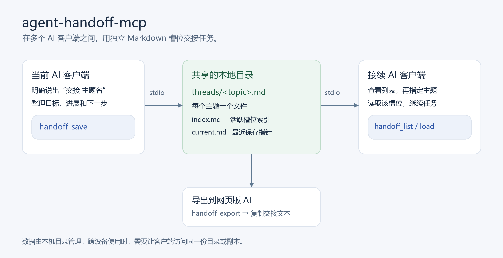

# agent-handoff-mcp

跨 AI Agent 的本地对话交接工具，提供 **MCP Server、CLI 和通用 Skill**。把当前对话的目标、进展、决策和下一步保存为独立 Markdown 槽位，在另一个 Agent 中按主题恢复。

[提交问题](https://github.com/648428732qq-sketch/agent-handoff-mcp/issues/new?template=bug_report.yml) · [功能建议](https://github.com/648428732qq-sketch/agent-handoff-mcp/issues/new?template=feature_request.yml) · [Fork 本项目](https://github.com/648428732qq-sketch/agent-handoff-mcp/fork) · [提交 Pull Request](https://github.com/648428732qq-sketch/agent-handoff-mcp/compare)

适用于支持本地 stdio MCP 的客户端。Antigravity、Codex、Claude Code、Cursor 等可按下面的方式配置；Trae、WorkBuddy 等可在各自 MCP 设置中填写相同的启动参数。网页版 AI 可以使用导出的交接文本。



*流程图展示保存当前现场、按主题索引、在另一 Agent 恢复或导出的过程。*

## 工作方式

- **MCP Server** 提供保存、列出、加载、关闭、导出和诊断工具，由客户端启动本地 Node.js 进程，通过 stdio 通信。
- **CLI** 支持查看和导出已有槽位、关闭归档，以及诊断接入问题。
- **Skill** 指导 Agent 在用户明确要求交接时保存，按主题恢复，并在多个候选之间请求选择。
- **Markdown 目录** 保存实际交接内容。多个客户端指向同一个目录，就能使用同一组槽位。

默认目录为 `~/.agent-handoff/`，也可以指向 Obsidian Vault 的 `_handoff/`。

```text
.agent-handoff/
├── index.md                 活跃槽位目录
├── current.md               最近一次保存的指针
├── threads/
│   ├── 语音唤醒延迟.md       一个对话的交接正文
│   └── rag-research.md       另一个对话的交接正文
└── _logs/
    └── agent-handoff.jsonl   诊断日志
```

正文包含 Frontmatter，以及“当前目标”“已完成进展与关键文件”“关键决策与踩坑”“下一步行动”四节。主题名保留中文、字母、数字、`_` 和 `-`，其余字符转换为 `-`。

## 使用前置条件

| 条件 | 适用情况 |
|---|---|
| Node.js 与 npm | 本地运行必需。项目声明 Node.js ≥ 18.18.0，已通过 Windows、Linux 的 Node.js 20／22 CI，以及本机 Node.js 24.14 验证。安装 Node.js 时通常同时安装 npm。 |
| 支持本地 stdio MCP 的 AI 客户端 | 通过 Agent 调用 MCP 工具时需要。客户端应能启动本机 Node.js 进程。 |
| 可写的数据目录 | 默认使用 `~/.agent-handoff/`。也可通过 `HANDOFF_DIR` 或 CLI 的 `--dir` 指定。程序会创建所需目录，运行账号需有写权限。 |
| Git | 从 GitHub 克隆源码时需要。 |
| 依赖下载网络 | 首次执行 `npm ci` 或下载 npm 包时需要访问 npm 注册表；构建完成后，Markdown 存储在本机运行。 |
| Obsidian／现有 Wiki | 可选。可以直接用默认目录，也可以将交接目录放到已有 Obsidian Vault 中。 |
| 共享目录或文件同步 | 多个客户端接续同一任务时，需能读取同一组交接文件。跨设备使用时，由使用者提供目录同步或共享访问。 |

交接存储本身无需数据库、Obsidian 插件或 API Key。工具只管理明确保存的交接摘要；已有 Wiki 的其他文章不会自动导入或被全文检索。AI 客户端的账号与模型接入由客户端自行配置。

### 接入已有 Obsidian Wiki

假设 Vault 位于 `C:/notes/wiki-vault`，在每个 MCP 客户端中设置相同的环境变量即可。

```json
{
  "HANDOFF_DIR": "C:/notes/wiki-vault/_handoff"
}
```

把这个对象放入后文 MCP 配置的 `env` 字段。程序在该位置维护 `index.md`、`current.md`、`threads/` 和 `_logs/`，Obsidian 可以直接查看其中的 Markdown。Vault 路径由本人选择，多个主题分别使用独立的槽位名。

如果已有 `SHARED_AGENTS.md`、`AGENTS.md` 或交接规则，让其目录约定与 `HANDOFF_DIR` 保持一致。仓库根目录的 `SKILL.md` 提供一份可安装的交接协议；已经采用等价规则的客户端可继续使用原有协议。

例如，终端中检查同一个 Wiki 交接目录时，运行 `node dist/src/cli.js doctor --dir C:/notes/wiki-vault/_handoff`。`init --dir` 只把目录写入客户端 MCP 配置，不会设置终端的环境变量；后续 CLI 命令仍需使用相同的 `--dir` 或 `HANDOFF_DIR`。

## 1. 安装和编译

项目声明支持 **Node.js ≥ 18.18.0**，本次验证环境为 **Node.js 24.14.0**。准备 Node.js、npm 和 Git，然后运行：

```bash
git clone https://github.com/648428732qq-sketch/agent-handoff-mcp.git
cd agent-handoff-mcp
npm ci
npm run build
node dist/src/cli.js --help
```

本仓库公开，可直接克隆源码。提交 Issue、Fork 或发起 Pull Request 时，请登录自己的 GitHub 账号。

编译入口为 `dist/src/cli.js`。下面假设项目位于 `C:/work/agent-handoff-mcp`，交接目录位于 `C:/AgentData/handoff`，请替换为本机实际的绝对路径。macOS、Linux 使用对应路径即可。

## 2. 配置 MCP 客户端

将服务注册为 `agent-handoff`。启动命令使用 `node`，参数指定编译后的入口。如果客户端找不到 Node.js，可以把 `command` 改成 `node` 可执行文件的绝对路径。

### JSON 配置

将下面的服务条目合并到客户端现有的 `mcpServers` 中：

```json
{
  "mcpServers": {
    "agent-handoff": {
      "command": "node",
      "args": ["C:/work/agent-handoff-mcp/dist/src/cli.js"],
      "env": {
        "HANDOFF_DIR": "C:/AgentData/handoff"
      }
    }
  }
}
```

源码中的配置辅助器使用以下文件位置。客户端版本或组织配置可能使用其他作用域，以当前客户端的配置入口为准。

| 客户端 | 配置位置 |
|---|---|
| Antigravity | `~/.gemini/antigravity/mcp_config.json` |
| Claude Code | `~/.claude.json` |
| Cursor | `~/.cursor/mcp.json` |
| Trae、WorkBuddy 等 | 在客户端 MCP 设置中填写命令、参数和环境变量 |

### Codex TOML 配置

在个人 `~/.codex/config.toml` 中添加：

```toml
[mcp_servers.agent-handoff]
command = "node"
args = ["C:/work/agent-handoff-mcp/dist/src/cli.js"]

[mcp_servers.agent-handoff.env]
HANDOFF_DIR = "C:/AgentData/handoff"
```

保存后重新加载 MCP 配置或重启客户端，确认能发现下面列出的六个工具。stdio 服务由客户端保持运行并接收工具请求。

### 关于 init 辅助器

```bash
node dist/src/cli.js init --target codex --dir C:/AgentData/handoff
```

支持目标 `antigravity`、`codex`、`claude`、`cursor`、`trae`、`workbuddy` 和 `all`，默认 `all`。前四项写入配置，Trae 和 WorkBuddy 输出供手动填写的 JSON。修改既有配置时生成 `.bak` 备份，Codex 已有同名服务时会跳过添加。

**当前辅助器生成的启动命令固定为 `npx -y agent-handoff-mcp`。** 它依赖 npm 上存在可用的同名包版本，GitHub 仓库上传本身不代表已完成 npm 发布。从本仓库源码安装时，采用上面的本地编译文件路径即可启动。

## 3. 安装 Skill

MCP 工具负责读写文件，仓库根目录的 `SKILL.md` 提供交接规则。支持 Agent Skills 的客户端可按各自的安装方式使用它。

Codex 用户可以从仓库根目录运行：

```powershell
$skillDir = Join-Path $env:USERPROFILE ".agents/skills/agent-handoff"
New-Item -ItemType Directory -Path $skillDir -Force
Copy-Item -LiteralPath ".\SKILL.md" -Destination (Join-Path $skillDir "SKILL.md")
```

安装后重新打开聊天，调用 `$agent-handoff`，或要求 Agent 按该 Skill 处理交接。Skill 使用已连接的 MCP 服务执行实际操作。

## 4. 完成一次交接

### 保存当前对话

在 Agent A 中输入：

> 交接 语音唤醒延迟。请保存当前目标、已完成进展、关键文件、关键决策和下一步行动。

Agent 总结后调用 `handoff_save`，返回槽位名和文件路径。Skill 建议正文精简到 40 行以内，便于接收方阅读。

底层参数示例：

```json
{
  "topic": "语音唤醒延迟",
  "goal": "- 降低语音唤醒响应延迟",
  "progress": "- 已定位音频缓冲参数，记录在项目测试报告中",
  "decisions": "- 保留流式输入，使用固定基线复测",
  "nextSteps": "- 对比调整前后的端到端延迟",
  "summary": "已完成缓冲定位，下一步复测延迟",
  "sourceAgent": "Codex",
  "project": "voice-demo",
  "workspace": "C:/work/voice-demo"
}
```

### 在另一 Agent 精准恢复

让 Agent B 使用相同的 `HANDOFF_DIR`，然后输入：

> 继续 语音唤醒延迟。

Agent 调用 `handoff_load`，读取指定槽位并继续下一步。支持唯一的部分名称匹配，例如只有一个相关主题时，可以使用“继续 唤醒”。

### 多个主题时先选择

输入“看交接”，Agent 会用 `handoff_list` 展示活跃槽位。只说“继续”且存在多个候选时，Skill 要求先列编号供用户选择。新话题按当前任务处理，恢复时明确主题可以减少上下文混用。

### 结束并归档

输入：

> 结束交接 语音唤醒延迟，并归档到 C:/AgentData/handoff-archive。

Agent 调用 `handoff_close`，先保存归档副本，再删除活跃槽位并更新索引。归档可选，未传归档目录时直接关闭槽位。

## 5. CLI 查看、导出和关闭

以下命令从仓库根目录执行，并使用同一数据目录：

```powershell
node dist/src/cli.js list --dir "C:/AgentData/handoff"
node dist/src/cli.js list --project "voice-demo" --dir "C:/AgentData/handoff"
node dist/src/cli.js load "语音唤醒延迟" --dir "C:/AgentData/handoff"
node dist/src/cli.js export "语音唤醒延迟" --dir "C:/AgentData/handoff"
node dist/src/cli.js close "语音唤醒延迟" --archive "C:/AgentData/handoff-archive" --dir "C:/AgentData/handoff"
```

`export` 输出包含交接正文的提示词，可以粘贴到 ChatGPT、Claude、Gemini 等网页版 AI。PowerShell 可以直接复制到剪贴板：

```powershell
node dist/src/cli.js export "语音唤醒延迟" --dir "C:/AgentData/handoff" | Set-Clipboard
```

CLI 负责处理已有槽位，保存当前聊天通过 MCP `handoff_save` 完成。

## 6. 诊断和反馈问题

遇到客户端接入、目录权限或交接操作问题时，在仓库根目录运行：

```powershell
node dist/src/cli.js doctor --dir "C:/AgentData/handoff"
node dist/src/cli.js report --dir "C:/AgentData/handoff" --lines 40
```

- `doctor` 显示 Node.js、系统版本、交接目录可写状态、活跃槽位数量和日志位置。
- 日志位于 `<HANDOFF_DIR>/_logs/agent-handoff.jsonl`，例如 `C:/AgentData/handoff/_logs/agent-handoff.jsonl`。
- `report` 输出可复制的 Markdown 环境报告、近期日志摘要和 GitHub Bug Issue 链接。`--lines` 控制收录的日志行数。
- 已连接 MCP 时，可以请 Agent 调用 `handoff_diagnostics` 获取诊断信息。

在服务环境变量中增加 `HANDOFF_DEBUG=1`，可同时把 JSONL 诊断输出到 stderr，供客户端排查。JSON 配置写成 `"HANDOFF_DEBUG": "1"`，Codex 的环境变量表中写成 `HANDOFF_DEBUG = "1"`。

报告会对部分路径和日志信息做摘要处理。提交 Issue 或发给其他人前，请核对实际输出中的路径、环境信息和日志摘要，按自己的数据共享要求删去敏感内容。

## MCP 接口

| 类型 | 名称 | 用途 |
|---|---|---|
| Tool | `handoff_list` | 列出活跃槽位，可按项目过滤 |
| Tool | `handoff_load` | 加载指定主题或唯一匹配的主题 |
| Tool | `handoff_save` | 保存或更新一个主题槽位 |
| Tool | `handoff_close` | 关闭槽位，可先归档 |
| Tool | `handoff_export` | 生成供网页版 AI 使用的交接文本 |
| Tool | `handoff_diagnostics` | 获取环境、目录状态和近期日志摘要 |
| Prompt | `save`、`resume`、`list` | 引导保存、恢复和列出操作 |
| Resource | `handoff://index` | 提供轻量槽位目录 |

Prompt 是否显示为斜杠命令，以及显示的名称，取决于客户端对 MCP Prompts 的支持。

## 数据位置和使用边界

- 服务把 Markdown 写入本机指定目录，运行无需独立远程服务器。加载正文后，内容会进入当前 AI 客户端的上下文，按该客户端的数据设置处理。
- 不同对话使用不同主题。再次保存同名主题会更新对应文件，需要保留两个现场时请使用不同主题。
- 多个客户端访问同一目录即可共享槽位。跨设备使用时，可以自行复制或同步目录，并协调写入时机。
- 保存触发和恢复选择由工具说明、Prompt、Skill 与客户端协作执行，存储层按调用参数处理读写。
- 当前对单文件采用临时文件加重命名写入。多进程同时更新索引和最近指针时，尚无跨进程锁或完整事务保证。
- 关闭槽位后，`current.md` 可能保留旧指针。判断可恢复内容时，以 `handoff_list` 或 CLI `list` 的活跃结果为准。

## 反馈问题与参与贡献

### 提交问题或建议

点击文首的“提交问题”或“功能建议”，即可打开对应的 GitHub 表单。提交前可以先查看[已有 Issues](https://github.com/648428732qq-sketch/agent-handoff-mcp/issues)，确认是否已有相关讨论。

报告问题时，请写明使用的客户端、系统和 Node.js 版本、复现步骤、预期结果及实际错误。能够运行诊断命令时，可以附上第 6 节的报告；安装或启动失败时，也可以直接描述问题。功能建议可以说明使用场景、期望行为和涉及的客户端。

### Fork 后提交改进

仓库已开放 Issues 和 Fork。任何登录的 GitHub 用户都可以将项目 Fork 到自己的账号，在个人副本中修改，再向本仓库提交 Pull Request，由维护者审核合并。

1. 点击文首的“Fork 本项目”，创建自己的仓库副本。
2. 将下面的 `YOUR_USERNAME` 替换为自己的 GitHub 用户名，在个人副本中新建分支。

```bash
git clone https://github.com/YOUR_USERNAME/agent-handoff-mcp.git
cd agent-handoff-mcp
git switch -c fix/describe-change
npm ci
```

3. 完成改动后运行测试，提交本次相关修改并推送到个人副本。

```bash
npm test
git add .
git commit -m "fix: describe your change"
git push -u origin fix/describe-change
```

4. 点击文首的“提交 Pull Request”，选择“compare across forks”。目标仓库选择 `648428732qq-sketch/agent-handoff-mcp`、目标分支选择 `main`，来源选择个人 Fork 的 `fix/describe-change` 分支。
5. 在 PR 中说明解决的问题、具体变化和验证结果。关联已有 Issue 时，在正文写 `关联 #编号`。

维护者会在 PR 中反馈审查意见，贡献者可继续向同一分支推送更新。

## 开发和验证

```bash
npm test
npm run build
```

`npm test` 会先编译 TypeScript，再运行现有三个测试。存储场景覆盖主题名处理、两个槽位的隔离、项目过滤、唯一匹配加载、文本导出，以及关闭和归档。测试中的两个槽位依次保存，多进程并发和各客户端界面接入需要另行验证。

本次上传前还使用 MCP SDK Client 完成了真实 stdio 冒烟，验证六个工具、三个 Prompt、一个 Resource 的发现，以及保存、列表、加载、导出、关闭、归档和诊断。CLI 的列表、加载、导出、`doctor` 和 `report` 也已验证。冒烟使用独立临时目录及合成示例。

项目使用 TypeScript。MCP 接口位于 `src/server.ts`，CLI 位于 `src/cli.ts`，Markdown 存储位于 `src/store.ts`，存储抽象 `HandoffStore` 位于 `src/types.ts`。

## License

[MIT](LICENSE)
